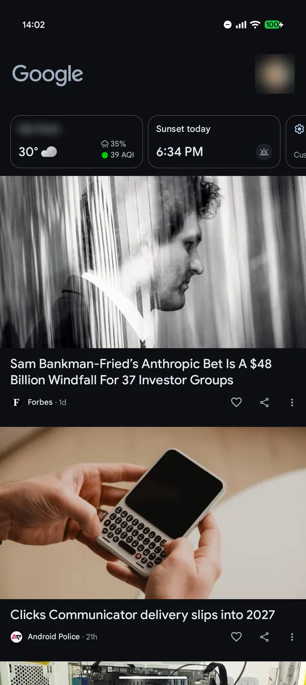
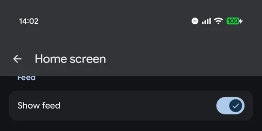

# Fugueti Feed

[](https://github.com/fugueti/feed/actions/workflows/release.yml)
[](LICENSE)
<!-- Release and download count badges: shields.io cannot read private repositories,
     so they show "repo not found" until the repository is public. Uncomment them then.
[](https://github.com/fugueti/feed/releases/latest)
[](https://github.com/fugueti/feed/releases)
-->

Small companion app that lets **[Fugueti](https://github.com/victorwalter/fugueti-launcher)**
show the Google feed (Google Discover) on the page to the left of the home screen.



## Install and use

1. Install [Fugueti](https://github.com/victorwalter/fugueti-launcher/releases/latest) and make it
   your home app.
2. Download `FuguetiFeed-<version>.release.apk` from the
   [latest release](https://github.com/fugueti/feed/releases/latest) and install it.
   It has no icon to open: it works in the background for Fugueti.
3. In Fugueti: long press the home screen → *Home settings* → *Home screen* → turn on
   **Show feed**.

   

4. Swipe right on the first home screen page to open the feed.

Fugueti finds the bridge by itself. While the feed is on and the bridge is missing, Fugueti's
settings show a red warning with a link to this page. `SHA256SUMS.txt` in each release lets you
check the download.

**Troubleshooting**

- Both apps must come from the official releases: the bridge only accepts Fugueti builds signed
  with the same key.
- The Google app must be installed and enabled.
- If the feed stops opening, force stop Fugueti (*Settings → Apps → Fugueti → Force stop*) and open
  it again.

## Why a separate app?

The Google app only connects its feed to launchers that are *debuggable* (development builds)
or system apps. Regular builds of Fugueti are neither, so Fugueti talks to the Google app through
this bridge instead:

1. Fugueti binds the bridge's `com.android.launcher3.WINDOW_OVERLAY` service.
2. The bridge binds the Google app's feed service **as itself** (it is debuggable, so the Google
   app accepts it) and hands Fugueti a binder that forwards every call.

Making Fugueti itself debuggable would expose the launcher's data over USB debugging, slow it
down and keep it out of the Play Store, so the debuggable part lives in this tiny app instead.

## Safety

- No permissions, no stored data, no network access of its own.
- Only accepts Fugueti builds (`app.fugueti.launcher*`) **signed with the same key** as this app.
- Fugueti recognizes the bridge by its signing certificate and prefers it over other bridges.

## Build

Requirements: JDK 17+ and the Android SDK (platform 37).

```bash
./gradlew :app:assembleRelease
```

Release signing reads `keystore.properties` (`storeFile`, `storePassword`, `keyAlias`,
`keyPassword`); it must be the same key used for Fugueti. Without it the APK is signed with the
debug key and Fugueti (release) will not use it.

## License

GPL-3.0-or-later (see [LICENSE](LICENSE)). The bridge interfaces in `app/src/main/aidl` come from
[Lawnchair](https://github.com/LawnchairLauncher/lawnchair) (Apache 2.0).
